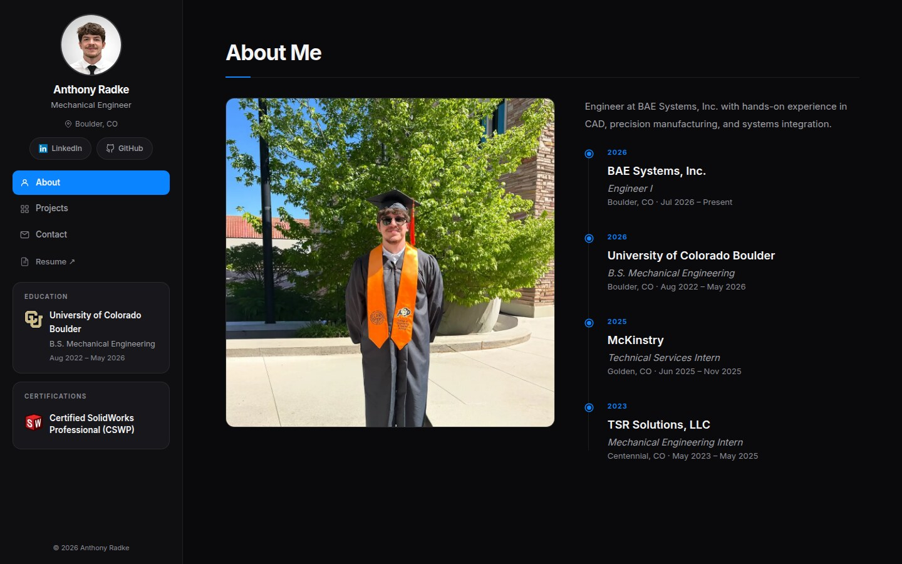

# anthonyradke.com

Source for [anthonyradke.com](https://anthonyradke.com), a mechanical engineering portfolio: mechanical design, CAD
and sheet metal work, and a full write-up of a senior capstone project, a precision seed dispenser built for Rooted
Robotics.

<p align="center">
  
</p>

## Stack

Hand-written HTML, CSS and JavaScript with no framework, dependencies or build step, served by GitHub Pages from
`main` on a custom domain. Pushing to `main` deploys.

## How it works

- The home page holds three sections (About, Projects, Contact) and shows one at a time. `js/main.js` switches
  between them with `history.pushState` and restores the section from the URL hash on `popstate`, so the back
  button and shared links work.
- Larger projects have their own page under `projects/`.
- The sidebar is a custom element, `<app-sidebar>`, defined in `js/sidebar.js` and shared by every page.
- Images are WebP. Those below the first screen use `loading="lazy"`.

## Layout

| Path | Contents |
|---|---|
| `index.html` | Home page |
| `projects/<name>/` | One folder per project page |
| `css/styles.css` | Styles |
| `js/main.js` | Section switching, mobile menu, copy-email button, certificate viewer |
| `js/sidebar.js` | The shared sidebar element |
| `fonts/` | Inter, self-hosted |
| `images/`, `files/` | Photos and renders; resume and certificate |

## Running locally

```sh
python3 -m http.server
```

## Editing

- Convert new images to WebP: `magick in.png -resize '1920x1920>' -quality 90 out.webp` (about 80 for photos).
- GitHub Pages caches files for 10 minutes. After changing CSS or JS, raise the `?v=` number where the file is
  linked in each HTML page.
- Add new pages to `sitemap.xml`.

## License

The code (HTML, CSS and JavaScript) is MIT licensed. Images, documents, project write-ups and other content are
not. See [LICENSE](LICENSE).
